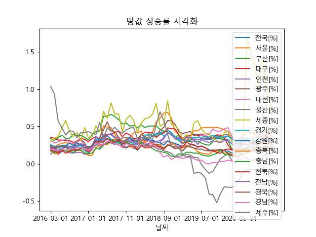

# 주요 자산 가격 데이터 비교·시각화

지역별 지가변동률, 세계 주요 주가지수, 암호화폐의 과거 가격 데이터를 불러와 그래프로 비교하는 Python 프로젝트입니다. 분석 기간은 코드에서 **2016년 3월 1일~2021년 3월 31일**로 설정되어 있으며 실제 범위는 데이터별 제공 이력에 따라 달라집니다.

## 주요 기능

- CSV에 저장된 전국·지역별 월간 지가변동률 조회 및 시각화
- FinanceDataReader로 KOSPI·다우·홍콩 HSI·영국 FTSE·닛케이 지수의 가격과 거래량 조회
- Bithumb 시세 데이터로 BTC·ETH·XRP 가격 시각화
- 종가의 최댓값·최솟값 비율과 가격 상승 관측 횟수를 계산해 콘솔에 출력

## 구성

| 파일 | 내용 |
| --- | --- |
| `main.py` | 데이터 로드·기간 필터링·통계 계산·그래프 출력 |
| `지역별지가변동률.csv` | 전국·지역별 월간 지가변동률 데이터 |
| `Figure_1.png`~`Figure_9.png` | 저장소에 보관된 시각화 결과 이미지 |
| `readme.txt` | 기존 실행 경로 설정 안내 |



## 실행 방법

Python 3, pandas, FinanceDataReader, pybithumb, Matplotlib와 인터넷 연결이 필요합니다. 사용하는 Python 환경에서 의존성을 설치합니다.

```bash
git clone https://github.com/JDW1224/OpenSW_Final.git
cd OpenSW_Final
python -m pip install pandas finance-datareader pybithumb matplotlib
```

기존 `readme.txt`의 안내대로 `main.py`의 `path` 값을 CSV가 있는 폴더로 수정해야 합니다. 저장소 루트에서 실행한다면 다음과 같이 설정합니다.

```python
path = './'
```

```bash
python main.py
```

Windows는 맑은 고딕, macOS는 AppleGothic을 사용하도록 구현되어 있습니다. 그 외 운영체제에서는 코드가 지정한 NanumBarunGothic 글꼴 경로를 확인해야 합니다.

## 확인할 점

- Python·라이브러리 버전이 고정되어 있지 않습니다. 특히 Linux 글꼴 처리의 `matplotlib.font_manager._rebuild()`는 내부 API이므로 설치한 Matplotlib 버전에 따라 수정이 필요할 수 있습니다.
- 외부 데이터 조회는 서비스의 응답과 제공 이력에 의존합니다. CSV의 마지막 관측값은 2021년 2월이며, 모든 자산이 동일한 기간을 보장하지는 않습니다.
- 출력되는 최댓값·최솟값 비율은 매수·매도 시점 순서를 고려한 백테스트가 아닙니다. 상승 관측 비율도 단순 과거 통계이며 향후 투자 수익 확률을 뜻하지 않습니다.
- 문서 작성 시 소스와 저장된 파일을 확인했으며 데이터 조회·그래프 실행은 재검증하지 않았습니다.
- 별도 라이선스 파일과 지가변동률 CSV의 원출처 표기는 저장소에서 확인되지 않습니다.
